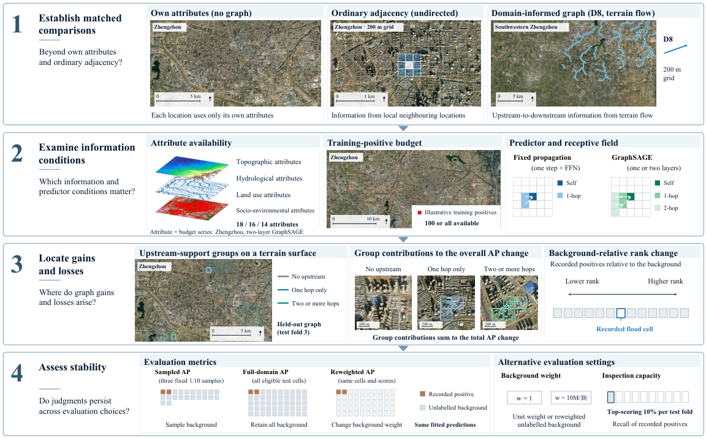

# A diagnostic framework for evaluating domain-informed graphs in urban flood identification

Code and aggregate results for the accompanying manuscript. The framework examines
the predictive increment of a domain-informed graph through reference comparisons,
modelling conditions, upstream-support groups and evaluation settings. The case
studies use terrain-derived D8 graphs and flood records from Zhengzhou (2021) and
Beijing (2023).

[Paper](paper/paper.pdf) · [Supplementary material](paper/supplementary.pdf) ·
[Data access](docs/DATA.md) · [Local reproduction](docs/REPRODUCING.md)



## Installation

Use Python 3.12 and [uv](https://docs.astral.sh/uv/getting-started/installation/).
The dependency versions are recorded in `uv.lock`.

```sh
git clone https://github.com/guchennn/A-diagnostic-framework-for-evaluating-domain-informed-graphs-in-urban-flood-identification.git flood-graph-diagnostics
cd flood-graph-diagnostics
uv sync --frozen --group figures
```

The commands below run on a CPU with the included aggregate data and synthetic
example. Run them from the repository root. Generated outputs go to `reproduced/`.

## Quick start

Recompute Tables 2 and 3 from the released fit-level and fold-level metrics, verify
the seed-sensitivity arithmetic supporting Table 4, and redraw Figures 3 and 4.

```sh
uv run python scripts/reproduce_tables.py
uv run python analysis/seed/verify_aggregate_arithmetic.py --output reproduced/seed/verification.json
uv run --group figures python plots/make_result_figures.py --output reproduced/figures
```

Run the small ranking example to inspect exact-tie handling, additive AP contributions
and background ranks.

```sh
uv run python scripts/diagnose_graph_ranking.py examples/ranking_diagnostic/synthetic.csv --output reproduced/ranking_example.json
```

Run all ten generated replicates of the synthetic validation experiment.

```sh
uv run python -m floodgnn_ceus.synthetic_diagnostic_validation --output reproduced/synthetic
```

The synthetic configuration fixes the grids, seeds, relationships, labels, spatial
partitions and validation-selected regularization. Reference outputs are in
`results/synthetic/`.

## Reproduce the city experiments

Acquire the seven source datasets from their providers, then prepare the two city
grids, environmental attributes, spatial folds and graphs. Dataset versions, download
links, account requirements, file locations and citations are documented in the data
guide. [Data access and attribution](docs/DATA.md).

Local model training uses the `train` dependency group, PyTorch 2.8.0,
PyTorch Geometric 2.7.0 and a CUDA 12.8-compatible NVIDIA GPU.

```sh
uv sync --frozen --group train --group figures
```

The local workflow records input hashes and the execution environment, runs the fixed
resource probe, selects hyperparameters within the inner spatial folds, and refits
the selected models for the outer folds. Follow the complete preparation, training
and analysis commands in the reproduction guide. [Local workflow](docs/REPRODUCING.md).

## Paper-to-code map

| Paper component | Implementation and released evidence |
| --- | --- |
| Study areas and 18 attributes | `src/floodgnn_ceus/`, `configs/`, `docs/DATA.md` |
| Matched graph and predictor comparisons | `reviewer_revision.py`, `models.py`, `e1.py`, `configs/reviewer_revision_v1.yaml` |
| Table 2, absolute performance | `scripts/reproduce_tables.py`, `results/absolute_performance/main_units.csv` |
| Table 3, ablation aggregates and budget-100 selection replay | `scripts/reproduce_ablation.py`, `docs/ABLATION.md`, `results/absolute_performance/ablation_absolute_folds.csv` |
| Figure 3, matched increments | `plots/make_result_figures.py`, `plots/data/fig3_*.csv` |
| Figure 4, structural contributions | `scripts/analyze_final_review_evaluation.py`, `plots/data/fig4_*.csv` |
| Table 4, seed sensitivity | `analysis/seed/`, `analysis/seed/data/observed_vs_seed_references.csv` |
| Evaluation and structural stability | `scripts/analyze_reviewer_training_structure.py`, `results/structural_stability/` |
| Synthetic validation | `synthetic_diagnostic_validation.py`, `configs/synthetic_diagnostic_validation_v1.yaml` |
| Figure 2, framework illustration | `plots/framework/Figure2_editable.pptx`, `plots/framework/Figure2.pdf` |

Paths naming package modules refer to `src/floodgnn_ceus/`. Figure input schemas,
group definitions and table fields are documented separately. [Figures and tables](docs/FIGURES_AND_TABLES.md).

## Repository layout

```text
src/floodgnn_ceus/   Data preparation, models and diagnostic methods
configs/            Fixed source, feature, graph and validation settings
scripts/            Analysis and reproduction entry points
analysis/seed/      Seed-sensitivity analysis and aggregate verification
plots/              Figure sources and aggregate plotting inputs
results/            Published aggregate numerical results
provenance/         Recorded selections, seeds and original protocol identity
examples/           Small synthetic ranking example
tests/              Numerical and workflow regression tests
docs/               Data access and reproduction instructions
paper/              Manuscript and supplementary PDF
```

Recorded flood locations and cell-level predictions are obtained or generated in the
reader's local `data/` and `artifacts/` directories. The released CSVs contain aggregate
metrics, counts, selections and seed identities. Their definitions distinguish recorded
positives from unlabelled background.

The published all-positive-label ablation is available as aggregate results. Its
original refit epochs and optimizer-seed records are incomplete, so exact FULL-fit
replay is unavailable. Budget-100 replay and the recorded scope are described in
the ablation guide. [Ablation reproduction](docs/ABLATION.md).

## Tests

```sh
uv run --group figures pytest -q --basetemp .pytest_tmp
uv run ruff check src scripts analysis plots tests
uv run ruff format --check src scripts analysis plots tests
```

Tests use synthetic inputs and released aggregates. GPU-specific model tests require
the training dependencies and a compatible GPU. The verification record lists the
commands actually run for this release. [Verification](docs/VERIFICATION.md).

## Citation and licence

Use the repository citation metadata for the software and cite each data provider
when reusing its dataset. [Software citation](CITATION.cff) · [Dataset BibTeX](docs/data_references.bib).

The original code is released under the MIT licence. Third-party datasets retain their
provider terms. [MIT licence](LICENSE) · [Data terms](docs/DATA.md).

For reproducibility questions or bug reports, open a repository issue with the command,
dependency versions and error message.
