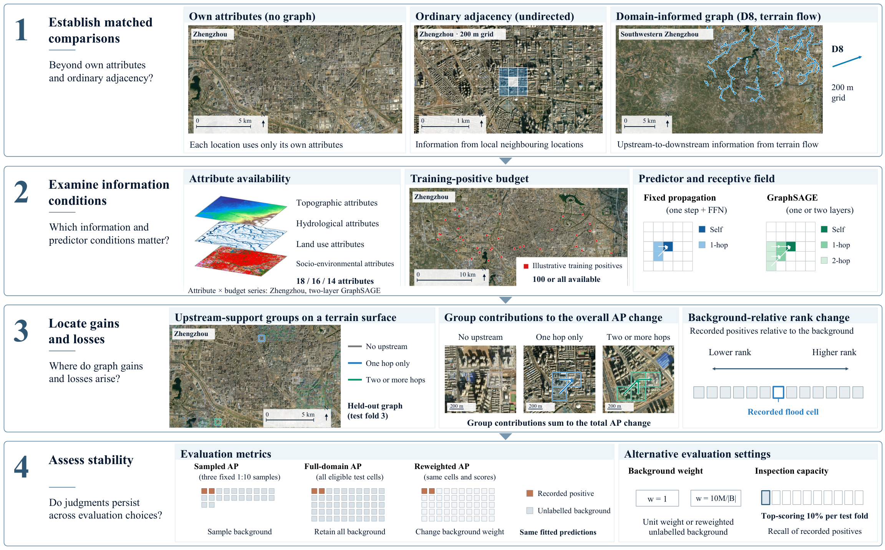

# Diagnosing the incremental value of domain-informed graphs for urban flood-report ranking: A multi-dimensional evaluation framework

Experiment code and numerical data for the Zhengzhou (2021) and Beijing (2023)
case studies, covering matched graph comparisons, attribute ablation, structural
decomposition, seed sensitivity and synthetic validation. The multi-dimensional
evaluation framework also examines local increments against both own attributes
and adjacency, and audits structural-group migration after spatial isolation.

[](assets/framework.png)

*Reference comparison, condition dependence, structural localization and evaluation
sensitivity. This is the framework used in the revised manuscript (Figure 2).
[Full-resolution image](assets/framework.png) · [Editable PowerPoint](assets/framework.pptx).*

## Latest diagnostic analyses

The November 2026 additions include executable code, aggregate results and
input/source hashes:

| Analysis | Entry point |
| --- | --- |
| Data alignment, six terrain attributes and graph construction | [Operation specification](reproduction/final_audit/Operational_specification.md) and [18-attribute ledger](reproduction/final_audit/feature_operations.csv) |
| Local increments against own attributes and adjacency | [Paired estimates](reproduction/final_audit/local_references/summary.csv) and [reproduction guide](reproduction/final_audit/README.md) |
| Full eligible-city to held-out graph-group migration | [Transition counts](reproduction/final_audit/group_migration/transition_matrix.csv) and [group-definition sensitivity](reproduction/final_audit/local_references/group_definition_sensitivity.csv) |
| Controlled ranking experiments and archived synthetic graph analyses | [Code, results and Figure 8](reproduction/controlled_validation/README.md) |
| Recovered FULL-budget records and city replay coverage | [Record audit](reproduction/recovery_audit/README.md) |
| Replacement attribute comparisons with independent selection | [Verified selections, refit metadata and aggregate checks](reproduction/selection_alignment/README.md) |
| Degree- and distance-matched local graph controls | [Construction, independent selection and paired analysis](reproduction/topology_controls/README.md) |

Verify the supplied final-audit aggregates with standard Python, without original
city observations or third-party packages:

```sh
python -I -S reproduction/final_audit/scripts/verify_aggregates.py
```

The supplied tables contain group, fold, fit or simulated-dataset summaries.
Cell-level city records and predictions remain local. Recomputing city diagnostics
requires the prepared graphs and a compatible frozen prediction run; the guides
distinguish that replay from checking the published aggregates. All commands below
run from the repository root and use relative paths.

### Completed topology-control evidence

The degree–distance matched G7 experiment now supplies 900 outer fits, 300 independent
selections and 960 validated partition graphs. All outcomes and interpretation limits
are documented in [the topology results](results/topology_controls/README.md).
Verify the published aggregates with
`python -I -S reproduction/topology_controls/verify_aggregates.py`.

## Install

Use Python 3.12. Create a virtual environment from the repository root.

```sh
git clone https://github.com/guchennn/A-diagnostic-framework-for-evaluating-domain-informed-graphs-in-urban-flood-identification.git flood-graph-diagnostics
cd flood-graph-diagnostics
python -m venv .venv
```

Activate it in your shell.

```sh
# Linux / macOS
source .venv/bin/activate
```

```powershell
# Windows PowerShell
.venv\Scripts\Activate.ps1
```

Install the pinned dependencies and the local package.

```sh
python -m pip install -r requirements.txt
```

## Run with the included data

These CPU commands recompute the performance and ablation tables, check seed
sensitivity, and run the ten-replicate synthetic experiment.

```sh
python scripts/reproduce_tables.py
python scripts/check_seed_results.py
python -m floodgnn_ceus.synthetic_diagnostic_validation --output reproduced/synthetic
```

Generated files go to `reproduced/`. Published numerical results are in `results/`.

## Run the city experiments

Acquire the source datasets, prepare both cities, then run local training and analysis.
Training uses PyTorch 2.8.0, PyTorch Geometric 2.7.0 and an NVIDIA GPU with CUDA 12.8.
Data sources, downloads and citations are listed below. Preparation, training
and analysis commands are in the running guide. [Experiment instructions](REPRODUCE.md).

## Data

Download the source datasets from their providers. Versions, identifiers, filters
and destination paths are configured in `configs/sources.yaml` and
`configs/cities/`. Follow the preparation commands in the running guide.
[Preparation](REPRODUCE.md#prepare-the-data).

| Dataset used | Access | Citation |
| --- | --- | --- |
| CrowdFlood v1, record 19921295 | Download from the authors' Zenodo record | Chen et al. (2026), [10.5281/zenodo.19921295](https://zenodo.org/records/19921295) |
| geoBoundaries CHN ADM2, commit `9469f09592ced973a3448cf66b6100b741b64c0d` | Public download | Runfola et al. (2020), [10.1371/journal.pone.0231866](https://doi.org/10.1371/journal.pone.0231866) |
| Copernicus DEM GLO-30 DGED 2024_1 | CDSE registration | European Space Agency and Airbus (2022), [10.5270/ESA-c5d3d65](https://doi.org/10.5270/ESA-c5d3d65) |
| ESA WorldCover 2021 v200 | Public S3 downloads | Zanaga et al. (2022), [10.5281/zenodo.7254221](https://zenodo.org/records/7254221) |
| GPM IMERG Final V07B, half-hourly 0.1° | NASA Earthdata account and GES DISC authorization | Huffman et al. (2023), [10.5067/GPM/IMERG/3B-HH/07](https://doi.org/10.5067/GPM/IMERG/3B-HH/07) |
| Historical OpenStreetMap through ohsome v1 | HeiGIT geometry queries | OpenStreetMap contributors and Raifer et al. (2019), [10.1186/s40965-019-0061-3](https://doi.org/10.1186/s40965-019-0061-3) |
| WorldPop R2024B v1, China unconstrained 100 m, 2021/2023 | Public raster downloads | WorldPop (2025), [release statement](https://data.worldpop.org/repo/prj/Global_2015_2030/R2024B/doc/Global2_Release_Statement_R2024B_v1.pdf) |

Complete citations are supplied in BibTeX. [data_references.bib](data_references.bib).

### Download details

- **CrowdFlood**. Download `CrowdFlood dataset.zip` from the authors' Zenodo page
  after reviewing its licence, and keep the archive intact. Preparation extracts
  `Zhengzhou_City_2021_7_19.csv` and `Beijing_2023_7_30.csv`, applies `pt_type_1=1`
  and merges records within 200 m cells. Expected totals are 791 and 296 recorded
  cells. Cite Chen et al. (2026) with the version-specific dataset DOI.
  [Official dataset and licence](https://zenodo.org/records/19921295).
- **Boundaries**. Select `Zhengzhoushi` (`17275852B14866353147502`) and
  `Beijingshi` (`17275852B40522342172572`).
  [Pinned GeoJSON](https://media.githubusercontent.com/media/wmgeolab/geoBoundaries/9469f09592ced973a3448cf66b6100b741b64c0d/releaseData/gbOpen/CHN/ADM2/geoBoundaries-CHN-ADM2.geojson).
- **Elevation**. The six DSM product IDs are fixed in the source configuration.
  The CLI requests CDSE credentials interactively.
  [Registration](https://documentation.dataspace.copernicus.eu/Registration.html).
- **Land cover**. Preparation downloads tiles N33E111 and N39E114 using the
  configured public S3 URLs. [Access and terms](https://esa-worldcover.org/en/data-access).
- **Rainfall**. Use collection `GPM_3IMERGHH`, version `07`, with filenames ending
  in `V07B.HDF5`. City settings include the 72-hour antecedent period and exact
  boundary filenames. [Earthdata registration](https://urs.earthdata.nasa.gov/),
  [dataset](https://disc.gsfc.nasa.gov/datasets/GPM_3IMERGHH_07/summary).
- **Roads and waterways**. Use snapshots `2021-08-04T08:58:00Z` and
  `2023-08-11T13:42:00Z`. The client uses v1. HeiGIT's newer v2 service requires
  an account/API key. [v1 metadata](https://api.ohsome.org/v1/metadata),
  [current API documentation](https://docs.ohsome.org/ohsome-api/v2/).
- **Population**. Use the two R2024B/v1 count rasters selected in
  `configs/sources.yaml`. Record the release and acquisition date when citing
  them. [WorldPop release](https://data.worldpop.org/repo/prj/Global_2015_2030/R2024B/).

### Storage and terms

Original files go under `data/raw/<source>/`. Derived grids and attributes go to
`data/interim/<city>/`. These local directories are excluded from Git. Shared
experiment aggregates and model settings are in `results/`.

CrowdFlood and WorldCover use CC BY 4.0. Obtain CrowdFlood records directly from
Zenodo under its terms. Follow Copernicus GLO-30's licence, NASA's data policy,
geoBoundaries attribution requirements and OSM's ODbL attribution. Check the terms
for each WorldPop asset, including the ODbL exception for products derived from
OSM/building data.
[Copernicus terms](https://dataspace.copernicus.eu/explore-data/data-collections/copernicus-contributing-missions/collections-description/COP-DEM),
[NASA policy](https://gpm.nasa.gov/data/policy), [OSM terms](https://www.openstreetmap.org/copyright),
[WorldPop guidance](https://www.worldpop.org/faq/).

## Contents

| Directory | Contents |
| --- | --- |
| `src/floodgnn_ceus/` | Data preparation, models and diagnostic methods |
| `configs/` | Dataset, feature, graph and experiment settings |
| `scripts/` | Evaluation and numerical reproduction |
| `results/` | Aggregate results, recorded selections and seeds |
| `tests/` | Numerical and workflow tests |
| `reproduction/` | Final operational audits, controlled validation, aggregate evidence and provenance |

```sh
python -m pytest -q --basetemp .pytest_tmp
```

The revised manuscript uses the independently selected October attribute series,
with 520 variant selections and 1,560 outer-fit records supplied separately from
the legacy September experiment. The legacy FULL records still have missing
metadata; those gaps do not describe the replacement series. Numerical reanalysis
of archived predictions is verified, while fresh public-code refit matching is
documented separately.
[Recovered records](reproduction/recovery_audit/README.md) ·
[Supported ablation scope](REPRODUCE.md#ablation).

## Citation and licence

Cite the software using `CITATION.cff` and the datasets using `data_references.bib`.
The code uses the MIT licence. Source datasets retain their provider terms.
[Software citation](CITATION.cff) · [Dataset citations](data_references.bib) · [MIT licence](LICENSE).
